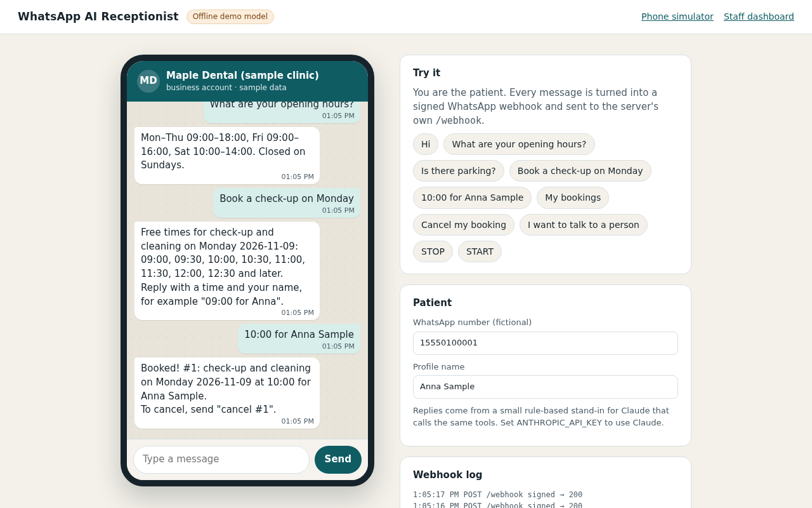
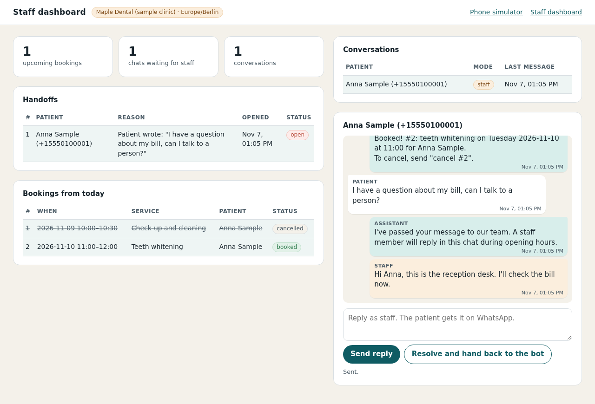

# WhatsApp AI Receptionist

A WhatsApp assistant for a small clinic or salon. Patients write to the business number. The assistant answers
questions from the clinic's FAQ, shows free times, books and cancels appointments, and passes the chat to a
staff member when it should not answer itself. Staff see bookings and waiting chats on a small dashboard and can
reply from there.

This is a personal portfolio project by Sunnatulla E. It is tested with unit tests against a mocked WhatsApp
Graph API and a scripted model, and with a Playwright browser test that runs the whole flow through a local phone
simulator. It has not been connected to a live WhatsApp Business number, and no real Claude conversation is part of
the test suite. The clinic, services, FAQ, names and numbers are sample data.

| Phone simulator (demo mode) | Staff dashboard |
| --- | --- |
|  |  |

## Try it in two minutes

No Meta app or API key needed:

```bash
npm ci
npm run build
npm run demo
```

Open <http://127.0.0.1:3000/simulator> and chat as a patient, for example "Book a check-up on Monday", then
"10:00 for Anna Sample". The staff dashboard is at <http://127.0.0.1:3000/admin> (demo login `admin` / `demo-admin`).

In demo mode:

- each message you type is turned into a Meta-shaped webhook payload, signed with a random per-process app secret on
  the server, and posted to the server's own `/webhook`, so it goes through signature checks, parsing and
  deduplication like a real one;
- outbound messages are kept in memory and shown on the simulated phone instead of being sent to the Graph API;
- without `ANTHROPIC_API_KEY`, an **offline demo model** answers. It is a small rule-based intent matcher, not an AI,
  that speaks the Messages API protocol (tool calls, then text), so the real agent loop, tools, booking rules and
  database are used. It understands simple English only. Set `ANTHROPIC_API_KEY` to have Claude answer instead.

Demo mode is for your own machine: the simulator has no login and the dashboard uses a known password. It listens on
`127.0.0.1` by default; don't expose it on a public address.

## Features

- **WhatsApp Cloud API webhook**: `GET /webhook` subscription check (`hub.verify_token`, `hub.challenge`), `POST /webhook`
  with `X-Hub-Signature-256` HMAC verification on the raw body (timing-safe compare).
- **Fast acknowledgement**: the webhook answers 200 right away; messages are processed in the background, one at a time
  per user, so replies stay in order.
- **Idempotent**: Meta redelivers webhooks; each WhatsApp message id is handled once (stored in SQLite).
- **Claude tool use**: a tool loop on the Anthropic Messages API (default model `claude-haiku-5-5`, set by env) with six tools:
  `faq_lookup`, `list_slots`, `book_appointment`, `list_my_bookings`, `cancel_appointment`, `handoff_to_human`.
  Tool inputs are validated with zod before anything runs; errors go back to the model as `is_error` results.
- **Safe by construction**: the WhatsApp number used by the tools comes from the webhook, never from the model, so a
  patient can only see and cancel their own bookings.
- **Booking rules**: opening hours, slot grid, no overlaps, minimum notice, booking horizon, limit of upcoming bookings
  per number.
- **Human handoff**: the bot stops replying in that chat and the handoff shows up on the dashboard. If the model fails,
  refuses, returns nothing or loops too long, the patient gets a polite fallback and the chat is handed off.
- **Staff dashboard** (`/admin`, basic auth): upcoming bookings, handoffs, conversations with the full transcript,
  "reply as staff" (sent over WhatsApp through the same policy rules) and "resolve" to give the chat back to the bot.
- **WhatsApp rules**: STOP / START opt-out, no messages to opted-out numbers, and an approved template instead of free
  text outside the 24-hour customer service window. Staff replies follow the same rules.
- **Per-user rate limit** (sliding window, the user is warned once).
- **Session memory**: the last 20 messages of the current 24-hour window are sent as context.

## Stack

Node.js 22, TypeScript (strict), Express 5, Anthropic TypeScript SDK, zod, SQLite through the built-in `node:sqlite`
module (no native build step), plain HTML/CSS/JS for the two pages (no framework, no external assets), Vitest,
Playwright, ESLint (typescript-eslint, type-checked rules).

## How it works

```
WhatsApp user ──> Meta Cloud API ──POST /webhook──> server.ts
   (or /simulator in demo mode)                     │ 1. verify X-Hub-Signature-256 on raw bytes
                                                    │ 2. parse + filter by phone number id
                                                    │ 3. dedupe by message id, queue per user, reply 200
                                                    ▼
                                            receptionist.ts
                       STOP/START · rate limit · handoff mode · session history
                                                    ▼
                                             agent/agent.ts  ⇄  Claude (or the offline demo model)
                                                    │              │
                                                    │        agent/tools.ts ──> clinic/booking.ts ──> SQLite
                                                    ▼                                                  ▲
                                         whatsapp/messenger.ts (opt-out, 24h window)                   │
                                                    ▼                                      admin/routes.ts (/admin)
                                 whatsapp/graph.ts ──> POST /{version}/{phone-number-id}/messages
                                 (demo/outbox.ts in demo mode)
```

```
src/
  server.ts            Express app: webhook, security headers, error handling
  receptionist.ts      per-message flow (opt-out, rate limit, handoff mode, history)
  agent/               tool loop, tool definitions, system prompt, LLM client interface
  clinic/              booking rules, time helpers, sample clinic data
  whatsapp/            payload parsing, signature check, Graph API client, messaging rules
  admin/               staff dashboard API + basic auth
  demo/                phone simulator API, in-memory outbox, offline demo model
public/                simulator and dashboard pages
test/                  Vitest unit and HTTP tests
e2e/                   Playwright browser test
```

## Run it for real

```bash
npm ci
cp .env.example .env     # fill in the values
npm run build
node --env-file=.env --disable-warning=ExperimentalWarning dist/main.js
```

### Connecting a WhatsApp number

1. Create a Meta app with the WhatsApp product and note the **Phone number ID** and a **system user access token**
   (`whatsapp_business_messaging`).
2. Copy the **App secret** (App settings → Basic) to `WHATSAPP_APP_SECRET`.
3. Expose the server over HTTPS (a VPS with a reverse proxy, or a tunnel while testing) and set the webhook URL to
   `https://<your-host>/webhook` with the same verify token as `WHATSAPP_VERIFY_TOKEN`. Subscribe to the `messages` field.
4. Set `ANTHROPIC_API_KEY`, and `ADMIN_PASSWORD` if you want the dashboard.

### Configuration

| Variable | Default | Purpose |
| --- | --- | --- |
| `PORT` / `HOST` | `3000` / `127.0.0.1` | Where the server listens (`0.0.0.0` in a container) |
| `WHATSAPP_VERIFY_TOKEN` | required | Token Meta sends when you save the webhook URL |
| `WHATSAPP_APP_SECRET` | required | Verifies `X-Hub-Signature-256` |
| `WHATSAPP_ACCESS_TOKEN` | required | Bearer token for sending messages |
| `WHATSAPP_PHONE_NUMBER_ID` | required | Sender number; webhooks for other numbers are ignored |
| `GRAPH_API_VERSION` | `v24.0` | Graph API version |
| `WHATSAPP_TEMPLATE_NAME` / `_LANG` | `hello_world` / `en_US` | Template used outside the 24-hour window |
| `ANTHROPIC_API_KEY` | | Key for Claude |
| `ANTHROPIC_MODEL` | `claude-haiku-5-5` | Model for the assistant |
| `LLM_EFFORT` | `low` | `low`, `medium` or `high` |
| `ADMIN_USER` / `ADMIN_PASSWORD` | `admin` / unset | Dashboard login; no password = dashboard off |
| `DEMO_MODE` | `0` | `1` = simulator, in-memory outbox, no WhatsApp credentials needed |
| `CLINIC_TIMEZONE` | `Europe/Berlin` | Time zone for slots and "today" |
| `RATE_LIMIT_PER_MINUTE` | `8` (`20` in demo) | Messages per user per minute |
| `DATABASE_PATH` | `./data/receptionist.db` | SQLite file |

Empty values (`KEY=`) count as unset.

## Tests

```bash
npm run check        # type check, lint, unit tests, build
npm run e2e          # Playwright: needs a browser (npx playwright install chromium, or CHROME_PATH=/path/to/chrome)
npm run screenshots  # same test, also writes docs/*.png
```

The unit tests never call WhatsApp or Anthropic. A `ScriptedLlm` plays fixed model responses (tool calls and text),
and a fake sender records outbound messages. They cover signature checks, the verify handshake, deduplication, the
tool loop (including invalid tool input, refusals, API failures and the step limit), booking rules, STOP/START, rate
limiting, handoff, the 24-hour template rule, Graph API retries, the dashboard API and its auth, the simulator, and
the offline demo model running through the real tools.

The Playwright test starts the built server in demo mode on a free port with a throwaway database and drives both
pages: FAQ answer, booking over two messages, cancel, a second booking, handoff, staff reply arriving on the phone,
resolve, and the bot answering again. It also fails on any browser console error.

## Limits

- One process: the rate limiter and the per-user queue live in memory. Several instances would need Redis or similar.
- One chair: bookings may not overlap at all. Several staff members would need a resource column.
- Text messages only; media gets a short "text only" reply.
- The dashboard uses basic auth for one shared staff login. A bigger team would want real user accounts.

## License

MIT
